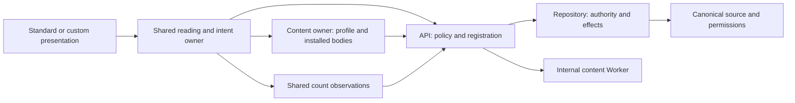

# System design

GitHub owns canonical Markdown, discussions and provider permissions. Deployment registration establishes immutable repository, installation and category identities. The API applies website policy and routes authority; the Repository Durable Object owns credential renewal, sessions, immutable effect receipts and ranking coordination. Interpretation executes in a separate content Worker without commenter credentials.

## Independent facts and availability

Reading, identity, participation, content and writing recovery have independent availability. The presentation shell appears immediately; slow body preparation or account verification must not block public reading or local drafting. Account changes retire principal-bound work while retaining the public traversal. [API reading](API.md#reading-document) and [session initialization](API.md#browser-session-and-initialization) define the projections.

Observation acceptance compares field ownership and original acquisition age, so delayed broad reads cannot replace newer narrow facts. Reading, count-only requests and effects feed the same count owner; cached reuse and replay preserve age. The [API reference](API.md#reading-document) owns count shapes and traversal semantics.

The content owner batches canonical inputs and binds installed bodies; presentations do not create another acquisition/cache layer. Detached preparation and installed-resource lifetimes are separate, keeping the current body usable during replacement. [Content contracts](API.md#content-and-counts) define commit, manifest and failure behavior; [extending](EXTENDING.md) shows a site-owned producer and consumer.

The internal producer has disposable artifact reuse, not repository state or commenter credentials. Its compiler is a separate trust boundary from article authoring and must enforce commenter-safe output. See [security](../SECURITY.md#comment-rendering).

## Intents and effects

Writing destination and intent identity are distinct: several records can target one destination. Independent contributions dispatch independently; only conflicting subject/field streams serialize. Issued intent remains recoverable as its original author, and a confirmed effect cannot become uncertain because optional observation failed. [Writing](API.md#writing), [contribution protocol](API.md#http-protocol) and [security](../SECURITY.md#interrupted-writes) define recovery and durable identity.

## Registration and prerequisites

Operators register repository/installation/category IDs during setup; one repository credential owner renews its token using that installation. Current GitHub results still establish relevant scope, visibility and permissions. Local prepared previews require deployment website policy and the content binding, not current provider admission. Session cleanup requires its stored authority, not a new repository discovery query.

Open hosting issues an installation-backed registration reference bound to its current policy. Ordinary requests cannot allocate arbitrary repository objects from unregistered input. Explicit configured policies override open defaults.

## Ranking and resources

Ranking acquires required score inputs separately from displayed bodies. Corrections do not silently reorder an existing traversal. [GitHub API use](GITHUB-API.md#display-and-ranking-queries) owns provider call requirements; [capacity](../FREE-TIER.md) owns resource costs and measurement, and [verification](../TESTING.md) owns evidence boundaries.
